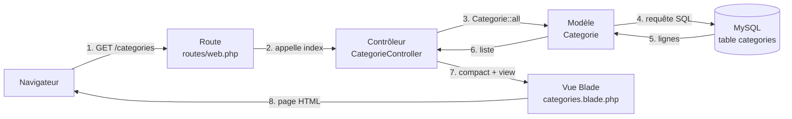

# Créer une application Laravel MVC avec MySQL

**Projet : `gestion-articles`**
**Objectif : afficher la liste des catégories depuis une base MySQL dans une page web**

> Présentation pédagogique pour débutants. Toutes les commandes sont prévues pour **Windows avec PowerShell**.

---

## Sommaire

1. Introduction
2. Prérequis
3. Création du projet Laravel
4. Configuration de MySQL
5. Création du modèle et de la migration
6. Le modèle `Categorie`
7. Le contrôleur
8. La route
9. La vue Blade
10. Exécution et résultat final
11. Comprendre le fonctionnement MVC
12. Partager le projet avec GitHub
13. Problèmes fréquents
14. Conclusion

---

## 1. Introduction

### Le projet

Nous allons construire une petite application nommée `gestion-articles`. Pour cette première étape, elle fait une seule chose : **lire les catégories enregistrées dans une base de données MySQL et les afficher dans une page web**.

### Qu'est-ce que Laravel ?

**Laravel** est un framework Web open source écrit en **PHP**. Un framework est une base de travail déjà organisée : il fournit une structure de projet et des outils pour les tâches courantes (routes, accès à la base de données, pages, validation, etc.).

### L'architecture MVC

MVC sépare l'application en trois rôles :

| Lettre | Nom | Rôle | Dans notre projet |
|---|---|---|---|
| **M** | Modèle (Model) | Représente les données et accède à la base | `Categorie` |
| **V** | Vue (View) | Prépare ce qui est affiché | `categories.blade.php` |
| **C** | Contrôleur (Controller) | Reçoit la demande, coordonne modèle et vue | `CategorieController` |

À ces trois éléments s'ajoute la **route**, qui indique quel contrôleur appeler pour une adresse donnée.

### Résultat visé

Une page `http://127.0.0.1:8000/categories` qui affiche la liste des catégories lues dans MySQL.

---

## 2. Prérequis

### Outils nécessaires

| Outil | Rôle |
|---|---|
| **PHP** | Langage utilisé par Laravel |
| **Composer** | Gestionnaire de dépendances PHP, sert à installer Laravel |
| **MySQL** | Système de gestion de base de données |
| **Visual Studio Code** | Éditeur de code |
| **Un navigateur** | Pour afficher le résultat |

> Sous Windows, PHP et MySQL peuvent être installés séparément ou via un pack comme XAMPP ou WAMP. Ce document ne dépend d'aucun pack en particulier.

### Vérifier les installations

Ouvrez PowerShell et exécutez :

**Commandes à exécuter dans le terminal**

```powershell
php -v
composer -V
mysql --version
```

Ces commandes affichent les versions installées. Si une commande n'est pas reconnue, l'outil n'est pas installé ou n'est pas dans le `PATH` de Windows.

> **Versions :** Laravel exige une version minimale de PHP qui change selon la version du framework. Vérifiez la page « Installation » de la [documentation officielle](https://laravel.com/docs) pour connaître la version requise par votre version de Laravel.

### Ouvrir le terminal dans Visual Studio Code

1. Ouvrez Visual Studio Code.
2. Menu **Terminal → Nouveau terminal**, ou raccourci `` Ctrl + ` ``.
3. Vérifiez que le terminal indique **powershell** (menu déroulant à droite du terminal).

### Résultat attendu

Les commandes `php -v` et `composer -V` affichent chacune un numéro de version, sans message d'erreur.

---

## 3. Création du projet Laravel

### Commandes

Placez-vous d'abord dans le dossier où vous rangez vos projets, puis :

**Commandes à exécuter dans le terminal**

```powershell
composer create-project laravel/laravel gestion-articles
cd gestion-articles
code .
```

### Explication de chaque commande

| Commande | Explication |
|---|---|
| `composer create-project laravel/laravel gestion-articles` | Télécharge Laravel et crée le dossier `gestion-articles` avec toutes les dépendances |
| `cd gestion-articles` | Se déplace dans le dossier du projet |
| `code .` | Ouvre le dossier dans Visual Studio Code (si la commande `code` est disponible) |

### Structure principale des dossiers

```text
gestion-articles/
├── app/
│   ├── Http/
│   │   └── Controllers/      ← les contrôleurs
│   └── Models/               ← les modèles
├── database/
│   ├── migrations/           ← la description des tables
│   └── seeders/              ← les données de démonstration
├── resources/
│   └── views/                ← les vues Blade
├── routes/
│   └── web.php               ← les routes web
├── .env                      ← la configuration locale (ne pas partager)
└── artisan                   ← l'outil en ligne de commande de Laravel
```

### Résultat attendu

Le dossier `gestion-articles` existe et contient les dossiers ci-dessus.

---

## 4. Configuration de MySQL

### 4.1 Créer la base de données `gestion_articles`

Connectez-vous à MySQL (le terminal vous demandera votre mot de passe) :

**Commande à exécuter dans le terminal**

```powershell
mysql -u root -p
```

Puis, dans la console MySQL :

**Commande SQL**

```sql
CREATE DATABASE gestion_articles CHARACTER SET utf8mb4 COLLATE utf8mb4_unicode_ci;
EXIT;
```

La base `gestion_articles` est créée vide. Laravel y créera les tables à l'étape suivante.

> **Alternative :** si vous utilisez phpMyAdmin, créez une base nommée `gestion_articles` avec l'interclassement `utf8mb4_unicode_ci`.

> **Attention :** `root` est un exemple courant, mais **chaque ordinateur peut avoir un utilisateur et un mot de passe différents**. Utilisez les vôtres.

### 4.2 Configurer le fichier `.env`

Ouvrez le fichier `.env` à la racine du projet et repérez les lignes `DB_...`. Modifiez-les ainsi :

**Code à écrire dans `.env`**

```env
DB_CONNECTION=mysql
DB_HOST=127.0.0.1
DB_PORT=3306
DB_DATABASE=gestion_articles
DB_USERNAME=root
DB_PASSWORD=votre_mot_de_passe
```

| Variable | Signification |
|---|---|
| `DB_CONNECTION` | Type de base de données (`mysql`) |
| `DB_HOST` | Adresse du serveur MySQL (ici, votre ordinateur) |
| `DB_PORT` | Port de MySQL (3306 par défaut) |
| `DB_DATABASE` | Nom de la base créée plus haut |
| `DB_USERNAME` | Votre utilisateur MySQL |
| `DB_PASSWORD` | Votre mot de passe MySQL |

> **Important :** `votre_mot_de_passe` est un texte d'exemple. Remplacez-le par votre vrai mot de passe, **sans jamais le partager**. Si votre utilisateur n'a pas de mot de passe, laissez la valeur vide : `DB_PASSWORD=`.

> **Versions :** selon la version de Laravel, le fichier `.env` peut être configuré par défaut pour **SQLite**, et certaines lignes `DB_...` peuvent être commentées avec `#`. Dans ce cas, supprimez le `#` devant les lignes utilisées et vérifiez que `DB_CONNECTION=mysql`.

### Résultat attendu

La base `gestion_articles` existe dans MySQL et le fichier `.env` contient vos identifiants.

---

## 5. Création du modèle et de la migration

### Commande Artisan

**Commande à exécuter dans le terminal**

```powershell
php artisan make:model Categorie -m
```

| Partie | Explication |
|---|---|
| `php artisan` | Lance l'outil en ligne de commande de Laravel |
| `make:model Categorie` | Crée le modèle `app/Models/Categorie.php` |
| `-m` | Crée aussi un fichier de **migration** dans `database/migrations/` |

Une **migration** est un fichier PHP qui décrit une table. Elle permet de créer la base de la même façon sur tous les ordinateurs.

### Code de la migration

Ouvrez le nouveau fichier dans `database/migrations/` (son nom ressemble à `2026_..._create_categories_table.php`) et remplacez son contenu par :

**Code à écrire dans le fichier de migration**

```php
<?php

use Illuminate\Database\Migrations\Migration;
use Illuminate\Database\Schema\Blueprint;
use Illuminate\Support\Facades\Schema;

return new class extends Migration
{
    public function up(): void
    {
        Schema::create('categories', function (Blueprint $table) {
            $table->id();
            $table->string('nom');
            $table->text('description')->nullable();
            $table->timestamps();
        });
    }

    public function down(): void
    {
        Schema::dropIfExists('categories');
    }
};
```

| Ligne | Colonne créée |
|---|---|
| `$table->id()` | `id` : identifiant automatique |
| `$table->string('nom')` | `nom` : texte court, obligatoire |
| `$table->text('description')->nullable()` | `description` : texte long, **facultatif** |
| `$table->timestamps()` | `created_at` et `updated_at` |

La méthode `up()` crée la table, `down()` la supprime lors d'un retour en arrière.

### Exécuter les migrations

**Commande à exécuter dans le terminal**

```powershell
php artisan migrate
```

Cette commande crée la table `categories`, ainsi que quelques tables par défaut de Laravel (utilisateurs, cache, etc.). C'est normal.

### Et si la migration a déjà été exécutée avant l'ajout de `description` ?

Laravel mémorise les migrations déjà exécutées : relancer `php artisan migrate` **ne modifiera pas** une table existante. Deux solutions :

**Solution A : en développement, sans données importantes.** Cette commande **supprime toutes les tables** puis les recrée :

```powershell
php artisan migrate:fresh
```

**Solution B : conserver les données.** Créez une migration qui ajoute la colonne :

```powershell
php artisan make:migration add_description_to_categories_table --table=categories
```

Puis écrivez dans le nouveau fichier :

```php
<?php

use Illuminate\Database\Migrations\Migration;
use Illuminate\Database\Schema\Blueprint;
use Illuminate\Support\Facades\Schema;

return new class extends Migration
{
    public function up(): void
    {
        Schema::table('categories', function (Blueprint $table) {
            $table->text('description')->nullable()->after('nom');
        });
    }

    public function down(): void
    {
        Schema::table('categories', function (Blueprint $table) {
            $table->dropColumn('description');
        });
    }
};
```

Puis exécutez :

```powershell
php artisan migrate
```

### Résultat attendu

Le terminal affiche les migrations exécutées avec la mention `DONE`. Dans MySQL, la table `categories` existe avec les colonnes `id`, `nom`, `description`, `created_at` et `updated_at`.

---

## 6. Création du modèle `Categorie`

Ouvrez `app/Models/Categorie.php` et remplacez son contenu par :

**Code à écrire dans `app/Models/Categorie.php`**

```php
<?php

namespace App\Models;

use Illuminate\Database\Eloquent\Model;

class Categorie extends Model
{
    protected $table = 'categories';

    protected $fillable = [
        'nom',
        'description',
    ];
}
```

### Explications

- **Le modèle** représente une ligne de la table `categories`. Il permet de lire et d'écrire des données sans écrire de SQL à la main (c'est le rôle d'**Eloquent**, l'ORM de Laravel).
- **`$table = 'categories'`** indique explicitement le nom de la table. Le nom de classe est en français (`Categorie`) alors que Laravel suppose des noms anglais : l'écrire évite toute ambiguïté.
- **`$fillable`** liste les champs qui peuvent être enregistrés en une seule fois (par exemple avec `create()`). C'est une protection contre l'enregistrement de champs non prévus.

### Résultat attendu

Le fichier est enregistré. Aucune page n'est encore visible : le modèle seul n'affiche rien.

---

## 7. Création du contrôleur

### Commande

**Commande à exécuter dans le terminal**

```powershell
php artisan make:controller CategorieController
```

Cette commande crée le fichier `app/Http/Controllers/CategorieController.php`.

### Code complet

**Code à écrire dans `app/Http/Controllers/CategorieController.php`**

```php
<?php

namespace App\Http\Controllers;

use App\Models\Categorie;

class CategorieController extends Controller
{
    public function index()
    {
        $categories = Categorie::all();

        return view('categories', compact('categories'));
    }
}
```

### Explications

| Élément | Rôle |
|---|---|
| `use App\Models\Categorie;` | Importe le modèle pour pouvoir l'utiliser |
| `index()` | Méthode appelée quand on veut afficher la liste |
| `Categorie::all()` | Récupère **toutes** les lignes de la table `categories` |
| `compact('categories')` | Crée le tableau `['categories' => $categories]` pour transmettre la variable à la vue |
| `view('categories', ...)` | Charge le fichier `resources/views/categories.blade.php` et lui envoie les données |

### Résultat attendu

Le contrôleur est enregistré. Il ne sera appelé qu'une fois la route créée.

---

## 8. Création de la route

Ouvrez `routes/web.php` et ajoutez le code suivant **à la fin du fichier** (gardez les routes existantes) :

**Code à écrire dans `routes/web.php`**

```php
<?php

use App\Http\Controllers\CategorieController;
use Illuminate\Support\Facades\Route;

Route::get('/categories', [CategorieController::class, 'index'])->name('categories.index');
```

> Si le fichier contient déjà `use Illuminate\Support\Facades\Route;`, ne le dupliquez pas : ajoutez seulement la ligne `use App\Http\Controllers\CategorieController;` et la ligne `Route::get(...)`.

### Explications

- **`Route::get('/categories', ...)`** : quand le navigateur demande l'adresse `/categories` avec la méthode GET, cette route est utilisée.
- **`[CategorieController::class, 'index']`** : Laravel appelle la méthode `index()` du contrôleur `CategorieController`.
- **`->name('categories.index')`** : donne un nom à la route, pratique pour créer des liens plus tard.

Pour vérifier que la route est bien enregistrée :

```powershell
php artisan route:list
```

### Résultat attendu

La liste des routes contient une ligne `GET|HEAD  categories` associée à `CategorieController@index`.

---

## 9. Création de la vue Blade

### Créer le fichier

Dans le terminal PowerShell, depuis la racine du projet :

**Commande à exécuter dans le terminal**

```powershell
New-Item resources/views/categories.blade.php -ItemType File
```

Vous pouvez aussi créer le fichier avec VS Code (clic droit sur `resources/views` → **Nouveau fichier**). Le nom doit se terminer par `.blade.php`.

### Code HTML complet

**Code à écrire dans `resources/views/categories.blade.php`**

```html
<!DOCTYPE html>
<html lang="fr">
<head>
    <meta charset="UTF-8">
    <meta name="viewport" content="width=device-width, initial-scale=1.0">
    <title>Liste des catégories</title>
    <style>
        body { font-family: Arial, sans-serif; max-width: 600px; margin: 40px auto; padding: 0 16px; }
        h1 { color: #333; }
        li { margin-bottom: 8px; }
        .vide { color: #888; font-style: italic; }
    </style>
</head>
<body>
    <h1>Liste des catégories</h1>

    <ul>
        @forelse ($categories as $categorie)
            <li>
                <strong>{{ $categorie->nom }}</strong>
                @if ($categorie->description)
                    : {{ $categorie->description }}
                @endif
            </li>
        @empty
            <li class="vide">Aucune catégorie n'existe pour le moment.</li>
        @endforelse
    </ul>
</body>
</html>
```

### Expressions Blade utilisées

| Expression | Explication |
|---|---|
| `@forelse ($categories as $categorie)` | Boucle sur chaque catégorie de la liste |
| `@empty` | Partie affichée **si la liste est vide** |
| `@endforelse` | Fin de la boucle |
| `{{ $categorie->nom }}` | Affiche la valeur du champ `nom`, en protégeant le HTML (échappement automatique) |
| `@if ... @endif` | Affiche la description seulement si elle existe |

### Résultat attendu

Le fichier est enregistré. Si la table est vide, la page affichera le message « Aucune catégorie n'existe pour le moment. ».

---

## 10. Exécution et résultat final

### Démarrer le serveur Laravel

**Commande à exécuter dans le terminal**

```powershell
php artisan serve
```

Cette commande lance un serveur local de développement. Laissez ce terminal ouvert tant que vous testez. Pour l'arrêter : `Ctrl + C`.

### Ouvrir la page

Dans le navigateur, allez à :

```text
http://127.0.0.1:8000/categories
```

### Résultat attendu (sans données)

Un titre « Liste des catégories » et le message « Aucune catégorie n'existe pour le moment. »

### Ajouter des données de démonstration

Pour que tous les participants voient les mêmes catégories, on utilise un **seeder** (un fichier qui insère des données de test).

**1. Créer le seeder**

```powershell
php artisan make:seeder CategorieSeeder
```

**2. Écrire son contenu dans `database/seeders/CategorieSeeder.php`**

```php
<?php

namespace Database\Seeders;

use App\Models\Categorie;
use Illuminate\Database\Seeder;

class CategorieSeeder extends Seeder
{
    public function run(): void
    {
        $categories = [
            ['nom' => 'Technologie', 'description' => 'Actualités et tutoriels sur le numérique.'],
            ['nom' => 'Sport', 'description' => 'Résultats, analyses et conseils sportifs.'],
            ['nom' => 'Culture', 'description' => null],
        ];

        foreach ($categories as $categorie) {
            Categorie::updateOrCreate(['nom' => $categorie['nom']], $categorie);
        }
    }
}
```

`updateOrCreate` évite les doublons : on peut relancer le seeder sans dupliquer les catégories.

**3. Exécuter le seeder**

```powershell
php artisan db:seed --class=CategorieSeeder
```

**4. Rafraîchir la page** `http://127.0.0.1:8000/categories`.

### Résultat attendu (avec données)

La page affiche une liste de trois éléments :

- **Technologie** : Actualités et tutoriels sur le numérique.
- **Sport** : Résultats, analyses et conseils sportifs.
- **Culture**

---

## 11. Comprendre le fonctionnement MVC

### Cheminement d'une requête



Si votre lecteur Markdown n'affiche pas les schémas Mermaid, voici la version texte :

```text
Navigateur → Route → Contrôleur → Modèle → MySQL
                          │
                          └→ Vue (Blade) → page HTML → Navigateur
```

### Explication simple de chaque élément

| Élément | Rôle dans notre projet |
|---|---|
| **Navigateur** | Envoie la demande `GET /categories` |
| **Route** | Reconnaît l'adresse et choisit le contrôleur |
| **Contrôleur** | Demande les données au modèle, puis les donne à la vue |
| **Modèle** | Parle à la base de données à la place du contrôleur |
| **MySQL** | Stocke les catégories |
| **Vue** | Transforme les données en page HTML lisible |

### Pourquoi séparer ainsi ?

Chaque partie a un seul rôle : on peut modifier l'affichage sans toucher à l'accès aux données, et inversement. Le code reste plus facile à lire et à faire évoluer.

---

## 12. Partager le projet avec GitHub

### Ne jamais partager le fichier `.env`

Le fichier `.env` contient vos identifiants MySQL. Laravel fournit un fichier `.gitignore` qui **exclut déjà `.env`** : il ne sera pas envoyé sur GitHub. Un fichier `.env.example` (sans secrets) sert de modèle pour les autres.

> Vérifiez avec `git status` que `.env` n'apparaît pas dans les fichiers à envoyer.

### Envoyer le projet (personne qui partage)

Créez d'abord un dépôt vide sur GitHub, puis :

```powershell
git init
git add .
git commit -m "Liste des catégories avec Laravel MVC"
git branch -M main
git remote add origin https://github.com/VOTRE-COMPTE/gestion-articles.git
git push -u origin main
```

Remplacez l'URL par celle de votre dépôt.

### Récupérer et lancer le projet (chaque participant)

**Prérequis :** PHP, Composer, MySQL et Git correctement installés.

```powershell
git clone https://github.com/VOTRE-COMPTE/gestion-articles.git
cd gestion-articles
composer install
Copy-Item .env.example .env
php artisan key:generate
```

Ensuite :

1. Créez la base `gestion_articles` dans MySQL (voir section 4.1).
2. Ouvrez `.env` et renseignez **vos propres** identifiants MySQL (voir section 4.2).
3. Exécutez :

```powershell
php artisan migrate
php artisan db:seed --class=CategorieSeeder
php artisan serve
```

4. Ouvrez `http://127.0.0.1:8000/categories`.

### Résultat attendu

Chaque participant voit les mêmes trois catégories dans son navigateur.

| Étape | Pourquoi |
|---|---|
| `composer install` | Les dépendances ne sont pas stockées dans GitHub |
| `Copy-Item .env.example .env` | Crée le fichier de configuration local |
| `php artisan key:generate` | Génère la clé de chiffrement propre à l'application |

---

## 13. Problèmes fréquents

| Erreur | Cause probable | Solution |
|---|---|---|
| `View [categories] not found` | Le fichier de vue n'existe pas, est mal nommé ou mal placé | Vérifier qu'il s'appelle exactement `categories.blade.php` et qu'il est dans `resources/views/` |
| Erreur de connexion MySQL (`Connection refused`, `Access denied`, `Unknown database`) | MySQL n'est pas démarré, identifiants incorrects ou base inexistante | Démarrer MySQL, vérifier `DB_USERNAME`, `DB_PASSWORD`, `DB_DATABASE` dans `.env`, créer la base `gestion_articles`. Puis exécuter `php artisan config:clear` |
| Table inexistante (`Base table or view not found`) | Les migrations n'ont pas été exécutées | Exécuter `php artisan migrate` |
| Erreur de namespace PHP (`Class "App\Models\Categorie" not found`) | Namespace, nom de classe ou nom de fichier incorrect | Vérifier `namespace App\Models;`, le nom de classe `Categorie` et le fichier `Categorie.php`. Vérifier aussi le `use` dans le contrôleur |
| Colonne `description` inexistante (`Unknown column 'description'`) | La table a été créée avant l'ajout de la colonne | Utiliser `php artisan migrate:fresh` (supprime les données) ou la migration d'ajout de colonne (section 5) |
| Port 8000 déjà utilisé | Un autre programme ou un autre serveur Laravel utilise le port | Lancer `php artisan serve --port=8001`, puis ouvrir `http://127.0.0.1:8001/categories` |

### Conseil général

Lisez toujours le **message d'erreur complet** : il indique généralement le fichier et la ligne concernés.

---

## 14. Conclusion

### Ce qui a été réalisé

- Création d'un projet Laravel nommé `gestion-articles`.
- Connexion à une base MySQL `gestion_articles`.
- Création de la table `categories` avec une migration.
- Création du modèle `Categorie`, du contrôleur `CategorieController`, de la route `/categories` et de la vue `categories.blade.php`.
- Ajout de données de démonstration avec un seeder.
- Préparation du partage du projet sur GitHub, sans le fichier `.env`.

### Rôle de chaque composant MVC

| Composant | Rôle |
|---|---|
| **Route** | Relie une adresse à une action |
| **Contrôleur** | Coordonne la demande |
| **Modèle** | Accède aux données |
| **Vue** | Affiche le résultat |

### Amélioration future

Ajouter les opérations **CRUD** complètes : **ajouter**, **modifier** et **supprimer** des catégories, avec des formulaires, de la validation et un contrôleur de type ressource (`Route::resource`).

**Source :** [Documentation officielle de Laravel](https://laravel.com/docs)