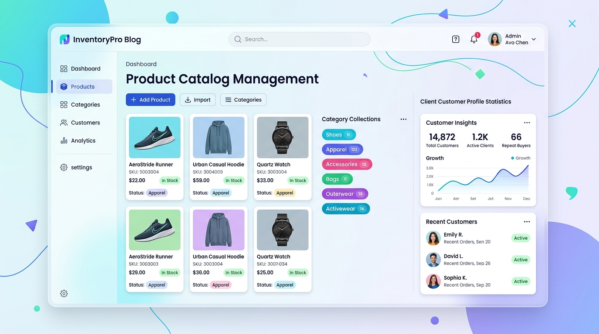

# Guide Markdown : Apprendre et Organiser un Document
## Présentation du projet : Blog de gestion des produits


 
## 1. Plan

- **Présentation du projet** : Sujet et objectif du blog de gestion des produits.
- **Définitions** : Notions de base de Markdown 
- **Guide des éléments Markdown** : Syntaxe et exemples concrets avec les 3 tables (titres, texte, listes, liens, images, code SQL/JSON, tableaux, tâches).
- **Conclusion** : Résumé des apprentissages 


## 2. Introduction au Projet

### Sujet du projet
Ce projet est un site web (blog) pour gérer et présenter des produits en ligne.
Il contient **3 tables de données principales** :
- `clients` : Les personnes qui achètent sur le site.
- `products` : Les articles en vente avec leur titre et leur prix.
- `collection` : Les catégories pour classer les articles (ex : Mode, Maison, Sport).

### Objectif du projet
Le but de ce blog technique est de :
- Afficher les produits de façon claire, moderne et agréable.
- Aider les clients à trouver facilement un article par catégorie.
- Faciliter le travail de l'équipe pour ajouter ou modifier des produits.

### Pourquoi utiliser Markdown ?
- Markdown est un format simple, léger et très facile à lire.
- Il permet de structurer un document sans outil payant ou compliqué.
- C'est le standard pour la documentation des projets informatiques.


## 3. Définitions

- **Markdown** : Un langage simple pour mettre en page un texte avec des symboles (`#`, `**`, `-`).
- **Document structuré** : Un texte bien organisé avec des titres hiérarchisés, des paragraphes courts et des listes.


## 4. Guide Pratique des Éléments Markdown

Dans cette partie, nous découvrons tous les éléments de syntaxe Markdown avec un exemple issu du blog de gestion des produits.

### Les Titres

On utilise le symbole `#` en début de ligne pour créer des titres :
- `#` = Titre de niveau 1 (grand titre).
- `##` = Titre de niveau 2 (titre de section).
- `###` = Titre de niveau 3 (sous-titre).

**Syntaxe :**
```markdown
# Blog Gestion des Produits
## Collection Vêtements
### Fiche : Veste en Jean
```

**Exemple du projet :**
Le grand titre présente le nom du blog, le sous-titre présente une collection précise.


### Mise en valeur du texte (Gras, Italique, Barré, Code)

- **Gras** : On place deux étoiles autour du texte (`**mot**`).
- *Italique* : On place une étoile autour du texte (`*mot*`).
- ~~Barré~~ : On place deux tildes autour du texte (`~~mot~~`).
- `Code en ligne` : On place deux accents graves (`` `mot` ``).

**Exemples du projet :**
- L'article est actuellement **en stock**.
- *Offre de bienvenue pour tous les nouveaux clients.*
- Ancien prix : ~~60 €~~ | Prix soldé : **40 €**.
- Le champ clé dans la base est `collection_id`.


### Les Listes à puces et numérotées

- **Liste à puces** : On écrit un tiret `-` au début de chaque ligne.
- **Liste numérotée** : On écrit un chiffre suivi d'un point (`1.`, `2.`, `3.`).

**Exemple du projet (Liste des collections disponibles) :**
- Collection Homme
- Collection Femme
- Collection Enfants
- Collection Accessoires

**Exemple du projet (Étapes pour un client) :**
1. Le client s'inscrit sur le blog.
2. Il consulte la table des catégories (`collection`).
3. Il sélectionne un article dans la table `products`.
4. Il confirme sa commande.


### Les Liens hypertextes

Pour créer un lien cliquable, on met le texte visible entre crochets `[Texte]` et l'adresse web entre parenthèses `(URL)`.

**Syntaxe :**
```markdown
[Texte visible](https://adresse-du-site.com)
```

**Exemples du projet :**
- [Consulter le catalogue des produits](https://monblog.fr/products)
- [Découvrir la collection Sport](https://monblog.fr/collection/sport)
- [Accéder à l'espace personnel du client](https://monblog.fr/clients/compte)


### Les Images

L'image s'écrit comme un lien, précédé d'un point d'exclamation `!`.

**Syntaxe :**
```markdown

```

**Exemple concret du projet :**


- Photo d'un article :
  ``
- Bannière de catégorie :
  ``


### Les Blocs de Code (SQL et JSON)

Pour afficher un bloc de code sur plusieurs lignes, on utilise trois accents graves ``` avec le nom du langage.

#### Exemple SQL : Création des 3 tables du blog
```sql
-- 1. Table des catégories
CREATE TABLE collection (
    id INT PRIMARY KEY,
    nom VARCHAR(50) NOT NULL
);

-- 2. Table des articles en vente
CREATE TABLE products (
    id INT PRIMARY KEY,
    nom VARCHAR(100) NOT NULL,
    prix DECIMAL(10,2) NOT NULL,
    collection_id INT,
    FOREIGN KEY (collection_id) REFERENCES collection(id)
);

-- 3. Table des acheteurs
CREATE TABLE clients (
    id INT PRIMARY KEY,
    nom VARCHAR(50) NOT NULL,
    email VARCHAR(100) UNIQUE NOT NULL
);
```

#### Exemple JSON : Données d'un produit
```json
{
  "id": 105,
  "nom": "Sac à dos Urbain",
  "prix": 39.99,
  "collection": "Accessoires",
  "disponible": true
}
```


### Les Citations et Remarques

On utilise le symbole chevron `>` en début de ligne pour mettre en avant une citation, un conseil ou un avis.

**Exemples du projet :**
> **Avis client :** "La commande est arrivée très vite. Les produits sont de très bonne qualité !"  
> — *Mona, cliente vérifiée.*

> **Règle importante :** Chaque produit de la table `products` doit obligatoirement être rattaché à un identifiant valide de la table `collection`.

### Les Tableaux

On utilise des barres verticales `|` pour séparer les colonnes et des tirets `-` sous la première ligne.

**Exemple du projet (Vue d'ensemble des 3 tables) :**

| Nom de la table | Description du rôle | Exemple de données réelles |
| :--- | :--- | :--- |
| `clients` | Enregistre les personnes qui commandent | Yassine (`yassine@email.com`) |
| `products` | Enregistre les articles en vente | Veste imperméable (Prix : 55 €) |
| `collection` | Regroupe les articles par univers | Collection Vêtements de Pluie |


### Les Cases à cocher (Tâches)

On écrit `- [ ]` pour une tâche à réaliser et `- [x]` pour une tâche complétée.

**Exemple du projet (Suivi des tâches du blog) :**
- [x] Créer la base de données avec les 3 tables (`clients`, `products`, `collection`).
- [x] Insérer les 5 premières catégories de produits.
- [x] Mettre en ligne les fiches des articles disponibles.
- [ ] Configurer les notifications par email pour les nouveaux `clients`.
- [ ] Lancer les soldes sur la collection d'hiver.


## 5. Conclusion

### Ce que nous avons appris
- Le langage Markdown permet d'organiser et de mettre en page un document de façon professionnelle.
- Les symboles simples (`#`, `**`, `-`, `|`, ```) rendent l'écriture rapide et agréable.
- Un document technique bien structuré permet de comprendre facilement l'architecture d'un projet (`clients`, `products`, `collection`).

